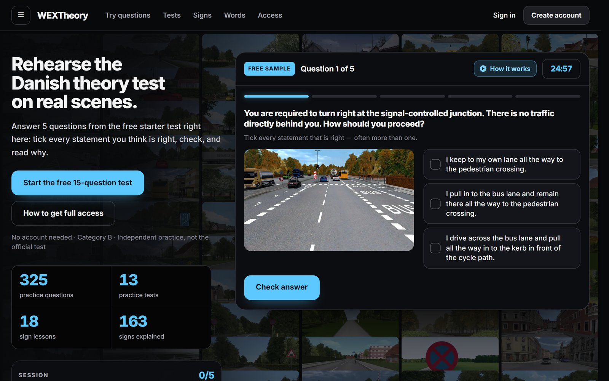
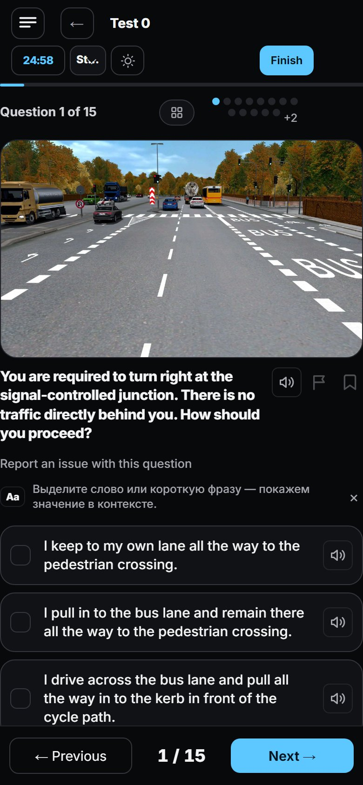
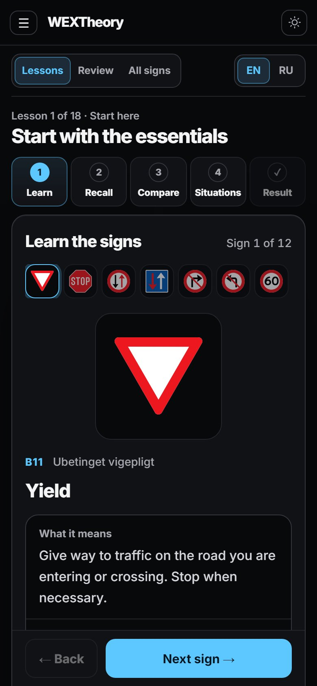
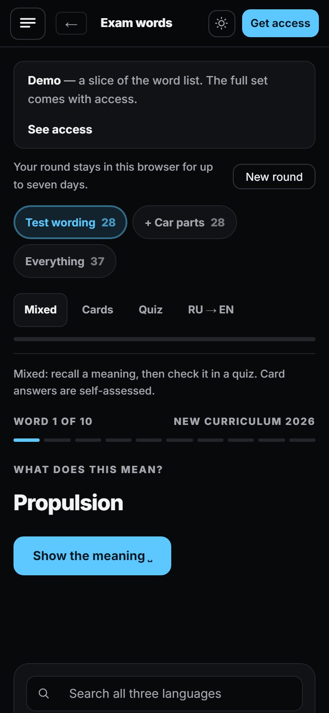

# WEXTheory

Practice for the Danish category B driving theory test — in English, with Russian help.

**[Open wextheory.cv](https://wextheory.cv)** · the 15-question starter test is free and needs no account



## What's inside

- **325 photo questions in 13 practice tests**, in the real test format: a road scene and several statements, each of them right or wrong.
- **Exam mode** — 25 mixed questions with the real pass mark of 20 out of 25.
- **Answer review** — every explanation in English with a Russian helper, the original test wording plus a plainer alternative.
- **Road signs** — 18 short lessons (learn, recall, compare look-alikes, situations) with spaced review after 1, 3, 7, 14 and 30 days, and the full sign catalogue.
- **Exam words** — vocabulary from the test with English–Russian practice.
- **Guides** — the 2026 training-rule changes, exam language and test-day costs.

<table>
  <tr>
    <td align="center"><br>Test question</td>
    <td align="center"><br>Sign lesson</td>
    <td align="center"><br>Exam words</td>
  </tr>
</table>

## Access

The starter test works without an account. A free account keeps your progress; full access to every test is arranged with the admin on Telegram.

## Built with

Python 3.11 · FastAPI · Jinja2 · PostgreSQL (SQLAlchemy) · plain JavaScript and CSS · hosted on Render

## Run it locally

```powershell
python -m venv .venv
.venv\Scripts\pip install -r requirements-dev.txt
.\start-local.ps1
```

The local preview uses its own SQLite database. Tests: `.venv\Scripts\python -m pytest`

---

WEXTheory is independent practice material, not the official Danish theory test.
